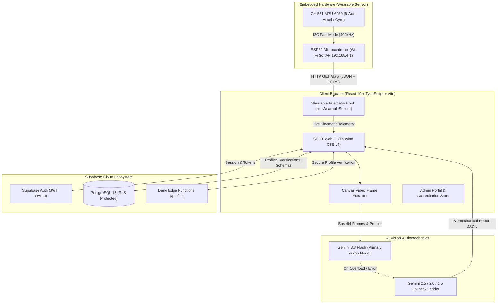
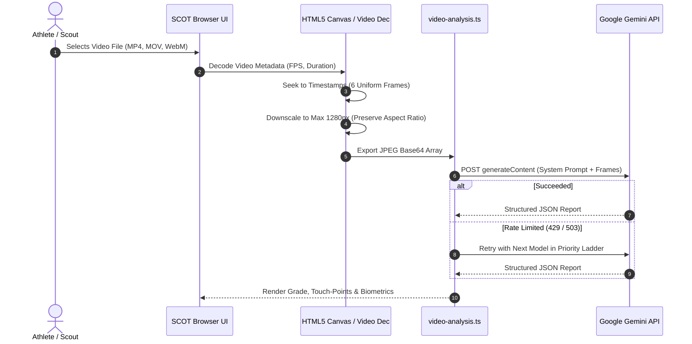

# SCOT — Serverless Athletic Intelligence Platform
## Complete Project Architecture, Technical Specifications, and Implementation Guide

> **Version**: 1.0.0 (Production Release)  
> **Target Runtime**: Browser Native (React 19 + TypeScript + Vite 8 + Tailwind CSS v4)  
> **Embedded Telemetry**: ESP32 Microcontroller + MPU-6050 6-Axis Kinematic IMU  
> **Cloud Backend**: Supabase (PostgreSQL 15+, Auth, Row-Level Security, Edge Functions)  
> **AI Vision Engine**: Google Gemini Multimodal SOTA API (with browser-native fallback chain)  
> **Repository**: [https://github.com/yussef2009/scout.1](https://github.com/yussef2009/scout.1)

---

## Table of Contents

1. [Executive Summary & Vision](#1-executive-summary--vision)
2. [High-Level Architecture](#2-high-level-architecture)
3. [Technology Stack](#3-technology-stack)
4. [User Roles & Security Clearance](#4-user-roles--security-clearance)
5. [Core Modules & Application Views](#5-core-modules--application-views)
   - 5.1 [Overview Dashboard (`Dashboard`)](#51-overview-dashboard-dashboard)
   - 5.2 [Full Interactive Scouting Dashboard (`FullDashboard`)](#52-full-interactive-scouting-dashboard-fulldashboard)
   - 5.3 [Athlete & Scout Profile (`Profile`)](#53-athlete--scout-profile-profile)
   - 5.4 [Media Center & Video Analysis Hub (`MediaCenter`)](#54-media-center--video-analysis-hub-mediacenter)
   - 5.5 [Biomechanical Performance Certification Report (`PerformanceReport`)](#55-biomechanical-performance-certification-report-performancereport)
   - 5.6 [Wearable Hardware Kinematics Lab (`Wearable`)](#56-wearable-hardware-kinematics-lab-wearable)
   - 5.7 [System Settings & AI Model Vault (`Settings`)](#57-system-settings--ai-model-vault-settings)
   - 5.8 [Secure Administrator & Accreditation Portal (`Admin`)](#58-secure-administrator--accreditation-portal-admin)
   - 5.9 [Authentication & Identity Modal (`AuthModal`)](#59-authentication--identity-modal-authmodal)
6. [Artificial Intelligence & Computer Vision Engine](#6-artificial-intelligence--computer-vision-engine)
   - 6.1 [Gemini Model Priority Ladder](#61-gemini-model-priority-ladder)
   - 6.2 [Video Processing & Frame Extraction Pipeline](#62-video-processing--frame-extraction-pipeline)
   - 6.3 [Player Detection, Jersey Identification & Kinematic Touch-Points](#63-player-detection-jersey-identification--kinematic-touch-points)
7. [Embedded Hardware & IoT Subsystem](#7-embedded-hardware--iot-subsystem)
   - 7.1 [Hardware Components](#71-hardware-components)
   - 7.2 [Pinout & Wiring Diagram](#72-pinout--wiring-diagram)
   - 7.3 [Firmware Architecture (PlatformIO / C++)](#73-firmware-architecture-platformio--c)
   - 7.4 [Telemetry Protocol & Network Streaming](#74-telemetry-protocol--network-streaming)
8. [Database Schema & Backend Services](#8-database-schema--backend-services)
   - 8.1 [Profiles Table & Row Level Security](#81-profiles-table--row-level-security)
   - 8.2 [Verification Requests Table](#82-verification-requests-table)
   - 8.3 [Dynamic Sport Schemas Table](#83-dynamic-sport-schemas-table)
   - 8.4 [Administrative Audit Logs](#84-administrative-audit-logs)
   - 8.5 [Supabase Edge Functions](#85-supabase-edge-functions)
9. [Project Directory & File Structure](#9-project-directory--file-structure)
10. [Setup, Installation, and Deployment Guide](#10-setup-installation-and-deployment-guide)
    - 10.1 [Prerequisites](#101-prerequisites)
    - 10.2 [Frontend Installation](#102-frontend-installation)
    - 10.3 [Supabase Backend Setup](#103-supabase-backend-setup)
    - 10.4 [Embedded Sensor Flashing](#104-embedded-sensor-flashing)
    - 10.5 [Build & Production Preview](#105-build--production-preview)
11. [Troubleshooting & Frequently Asked Questions](#11-troubleshooting--frequently-asked-questions)

---

## 1. Executive Summary & Vision

**SCOT** (Serverless Athletic Intelligence Platform) is an end-to-end sports biomechanics, computer vision, and talent scouting platform engineered to democratize access to elite sports science. Traditionally, high-precision kinematic analysis, jump tracking, ground reaction force estimation, and talent accreditation have been restricted to top-tier sports academies equipped with multi-million-dollar optical motion-capture laboratories (such as Vicon or Qualisys) and force plates.

SCOT changes this paradigm by delivering **laboratory-grade athletic intelligence directly through any modern web browser**:
- **Computer Vision Without Cloud GPU Overheads**: Extracts video frames locally in the browser canvas and leverages Google's multimodal Gemini models to deliver frame-by-frame biomechanical breakdowns, athlete identification, touch-point critique, and composite scouting grades.
- **Physical Wearable Telemetry**: Integrates with an ultra-affordable ESP32 + MPU-6050 6-axis IMU wearable sensor transmitting real-time kinematic acceleration and rotational velocity via local Wi-Fi.
- **Scout & Academy Verification**: Implements an enterprise accreditation tier verifying clubs and scouts through federated license validation, cryptographic report verification hashes, and comprehensive administrator audits.
- **Multi-Sport Flexibility**: Pre-configured with rich metric schemas for 10 Olympic and professional sports, accompanied by a dynamic admin schema manager for infinite sport expansions.

---

## 2. High-Level Architecture

The platform is designed around a decoupled, serverless, and browser-first architecture:



---

## 3. Technology Stack

| Layer | Technology | Version | Purpose / Key Features |
| :--- | :--- | :--- | :--- |
| **Frontend Framework** | React | `^19.0.0` | React 19 Concurrent Mode, Hooks, Suspense, and zero-overhead component rendering. |
| **Language** | TypeScript | `^5.7.0` | Strict static typing, type safety across all metrics, profiles, and API responses. |
| **Build Tooling** | Vite | `^8.0.5` | Instant HMR, optimized ESM bundling, zero-latency local development. |
| **Styling** | Tailwind CSS | `^4.0.0` | Tailwind CSS v4 via `@tailwindcss/vite`, CSS theme variables, dark mode first. |
| **Code Formatting** | oxfmt | `^0.2.0` | Ultra-fast Rust-based code formatter. |
| **AI / Multimodal** | Google Gemini API | REST / v1beta | `gemini-3.8-flash` primary vision engine with automatic multi-model fallback. |
| **Backend & Auth** | Supabase | `^2.117.3` | Managed PostgreSQL, Row Level Security (RLS), OAuth (Google, Facebook), Email auth. |
| **Serverless Functions**| Supabase Edge Functions | Deno runtime | JWT-verified profile server endpoints with CORS handling. |
| **Embedded Firmware** | PlatformIO / C++ | Arduino ESP32 | ESP32-WROOM-32 firmware reading GY-521 MPU-6050 over I2C and serving JSON via Wi-Fi AP. |

---

## 4. User Roles & Security Clearance

SCOT enforces a role-based access model that shapes the user interface, available tools, and database privileges:

```text
┌────────────────────────────────────────────────────────────────────────┐
│                        SCOT PLATFORM ROLES                             │
├─────────────────┬──────────────────┬─────────────────┬─────────────────┤
│     PLAYER      │  CLUB / ACADEMY  │  SCOUT / AGENT  │  ADMINISTRATOR  │
├─────────────────┼──────────────────┼─────────────────┼─────────────────┤
│ • Record clips  │ • Browse roster  │ • Deep search   │ • Verify clubs  │
│ • Run AI checks │ • Benchmark data │ • Export certs  │ • Accredit scots│
│ • Sensor stream │ • Team analytics │ • Scout notes   │ • Manage schemas│
│ • Share profile │ • Request verify │ • Digital audit │ • Full audit log│
└─────────────────┴──────────────────┴─────────────────┴─────────────────┘
```

1. **Player / Athlete**:
   - Access to personal dashboard, video upload for AI frame analysis, and live wearable sensor streaming.
   - Saves personal records (vertical jump, flight time, ground contact, acceleration).
   - Generates shareable athletic cards and printable performance reports.

2. **Club / Academy**:
   - Evaluates athlete cohorts against standardized physical benchmarks (e.g., sub-3.2s counter-press transition, 75+ cm vertical jump).
   - Submits formal club verification requests with official federation license documentation.
   - Unlocks verified organization badges upon administrator accreditation.

3. **Scout / Agent**:
   - Advanced search across local and national athlete pools with custom biometric filtering.
   - Issues verified scouting audits, digital signatures, and custom evaluative narratives.
   - Requires accreditation badges (e.g., FIBA, FIFA, National Federation Evaluator License).

4. **Administrator (Superadmin)**:
   - Protected clearance hidden from unauthenticated users; unlocked via dedicated administrator credentials.
   - Comprehensive control room: approves/rejects club and scout licenses, audits user accounts, bans bad actors, modifies sport metric schemas, and generates VIP accreditation codes.

---

## 5. Core Modules & Application Views

SCOT features a rich single-page application (SPA) architecture with modular view routing:

### 5.1 Overview Dashboard (`Dashboard`)
The primary hub displaying athletic intelligence signals:
- **Biomechanical Signal Filters**: Instant metric filters (e.g., Elite Vertical, Reactive Agility, Sprint Deceleration).
- **Interactive Leaderboard**: Visual ranking cards with athlete photo, score ring, verified badge, location flags, and key metrics.
- **Sport Selector Pill-Bar**: One-click switching between 10 supported Olympic and professional sports.
- **Demo Mode**: Instant toggle between realistic simulated athletic roster data (2,148+ ranked athletes) and live Supabase production data.
- **Notification Center**: Sliding real-time alert feed for talent inquiries, scout evaluations, and system notices.

### 5.2 Full Interactive Scouting Dashboard (`FullDashboard`)
Located in [`src/dashboard/FullDashboardPage.tsx`](file:///d:/scot1/src/dashboard/FullDashboardPage.tsx):
- **Extended Athlete Directory**: Filter by age bracket, team, country, city, and physical percentile.
- **Head-to-Head Comparison Matrix**: Compare two athletes side-by-side with radar charts, metric delta bars, and kinematic strengths/weaknesses.
- **Deep Biomechanical Stats**: Displays primary metric (e.g. Vertical Jump in cm), secondary metric (Hang Time in sec), and dynamic acceleration (m/s²).

### 5.3 Athlete & Scout Profile (`Profile`)
Located in `src/App.tsx`:
- Displays athlete biometrics, active sports, club affiliation, and residency details.
- History of verified performance reports with date, grade, score, and verification status.
- Personal media reels and training session logs.

### 5.4 Media Center & Video Analysis Hub (`MediaCenter`)
Located in [`src/media/MediaCenterPage.tsx`](file:///d:/scot1/src/media/MediaCenterPage.tsx):
- **Video Clip Library**: High-definition video reels organized by session, skill type, and match date.
- **Video Playback Modal**: Native in-browser video player with timestamp scrubber and playback controls.
- **Direct AI Evaluation**: One-click trigger to pass any recorded clip into the Gemini computer vision pipeline to produce an instant performance report.

### 5.5 Biomechanical Performance Certification Report (`PerformanceReport`)
Located in [`src/reports/PerformanceReportPage.tsx`](file:///d:/scot1/src/reports/PerformanceReportPage.tsx):
- **Laboratory Certification Protocol**: Formatted as an official athletic evaluation certificate (Protocol v4.2).
- **Customizable Report Layout**: Toggle biometric rings, radar charts, narrative text, strengths, areas of improvement, and QR verification blocks.
- **Cryptographic Verification Hash**: Features unique SHA-based report verification hashes (e.g. `0x8f9c42b103e226da1f8933bce82e`) verifiable by prospective collegiate scouts and professional clubs.
- **Export & Print**: Full CSS `@media print` styling for clean, high-resolution PDF generation and scout packet distribution.

### 5.6 Wearable Hardware Kinematics Lab (`Wearable`)
Located in [`src/wearable/WearablePage.tsx`](file:///d:/scot1/src/wearable/WearablePage.tsx):
- **Live Device Status Card**: Displays sensor connection status (Connected, Disconnected, Error, Polling), IP address, latency, and sample frequency.
- **Multi-Axis Kinematic Telemetry**: Live interactive SVG charts plotting tri-axial acceleration ($A_x, A_y, A_z$) and rotational velocity ($\omega_x, \omega_y, \omega_z$).
- **Dynamic Activity Classifier**: Computes instantaneous variance to classify motion into *Low Observed Motion*, *Moderate Locomotion*, or *High Explosive Spikes* (takeoffs/pivots).
- **Simulation Mode**: Built-in kinematic simulator generating realistic sinusoidal athletic movement curves when physical hardware is not present.

### 5.7 System Settings & AI Model Vault (`Settings`)
Located in `src/App.tsx`:
- **Theme & Accent Engine**: Seamless switching between Dark, Slate, High-Contrast Neon, and custom accent highlights.
- **Gemini Model Selector**: Choose preferred multimodal model from the dropdown; automatically manages fallback behavior.
- **API Key Vault**: Stores user-provided Google Gemini API keys in browser storage and encrypts/syncs to Supabase profile preferences.
- **Measurement Units**: Toggle between Metric (cm, m/s², kg) and Imperial (in, ft/s², lbs).
- **Geographic Scope**: Set default leaderboard focus to Town/City level vs National level.

### 5.8 Secure Administrator & Accreditation Portal (`Admin`)
Located in [`src/admin/AdminPortalPage.tsx`](file:///d:/scot1/src/admin/AdminPortalPage.tsx):
- **Verification Request Queue**: Review uploaded accreditation documents, federation licenses, and phone numbers for pending clubs and scouts.
- **One-Click Accreditation**: Approve clubs/scouts to issue verified checkmarks and generate unique VIP registration codes.
- **Dynamic Sport Schema Manager**: Add new sports, toggle active statuses, define customized kinematic metrics, and adjust min/max acceptable thresholds.
- **Administrative Audit Logs**: Immutable log tracking every administrative decision, target ID, admin email, and timestamp.

### 5.9 Authentication & Identity Modal (`AuthModal`)
Located in `src/App.tsx`:
- Supports standard Email/Password registration with instant Supabase session initialization.
- One-click OAuth via Google and Facebook.
- Club/Scout verification code validation (`SCOT-CLUB-VIP`, `FIFA-ACAD-2026`, etc.).
- Direct administrative sign-in recognition configured in [`src/admin/adminInfo.ts`](file:///d:/scot1/src/admin/adminInfo.ts).

---

## 6. Artificial Intelligence & Computer Vision Engine

The vision subsystem in [`src/video-analysis.ts`](file:///d:/scot1/src/video-analysis.ts) transforms raw smartphone video into biomechanical analytics without requiring specialized cloud servers.

### 6.1 Gemini Model Priority Ladder

To guarantee uninterrupted service even during peak API traffic or rate-limiting, SCOT implements a resilient fallback ladder:

```text
[1] gemini-3.8-flash        (Recommended · SOTA Multimodal Flagship)
        ↓  (On 429 Rate Limit / Overload / Unavailable)
[2] gemini-2.5-flash        (Fast High-Intelligence Multimodal)
        ↓
[3] gemini-2.5-flash-lite   (High-Throughput Lightweight Model)
        ↓
[4] gemini-2.5-pro          (Deep Biomechanical Reasoning)
        ↓
[5] gemini-3.1-pro-preview  (Latest Preview Model)
        ↓
[6] gemini-2.0-flash        (Proven Multimodal Workhorse)
        ↓
[7] gemini-2.0-flash-lite   (Lightweight Fallback)
        ↓
[8] gemini-1.5-flash        (Universal Fallback)
        ↓
[9] gemini-1.5-pro          (Deep Analysis Fallback)
```

### 6.2 Video Processing & Frame Extraction Pipeline



### 6.3 Player Detection, Jersey Identification & Kinematic Touch-Points

1. **Multi-Player Detection**: When analyzing game footage containing multiple athletes, the vision engine detects individual bounding regions, identifies jersey numbers, positions, and team colors, and allows the scout to pick which player to analyze.
2. **Phase-by-Phase Touch-Point Breakdown**:
   - Analyzes distinct biomechanical phases (e.g., *Approach Phase*, *Penultimate Step*, *Takeoff Phase*, *Rim Hang*, *Landing Phase*).
   - Assigns quality ratings (`Elite`, `Optimal`, `Suboptimal`, `Fault`).
   - Computes kinematic joint angles (e.g., Knee flexion: 118°, Trunk forward tilt: 14°).
3. **Structured Scouting Assessment**:
   - Overall Score (0–100) and Letter Grade ($A+, A, B, C, D$).
   - Strengths, Areas to Improve, and actionable Training Recommendations.

---

## 7. Embedded Hardware & IoT Subsystem

SCOT includes dedicated embedded firmware located in [`embedded/esp/espcode/`](file:///d:/scot1/embedded/esp/espcode/).

### 7.1 Hardware Components

- **Microcontroller**: ESP32 Development Board (ESP32-WROOM-32, 240MHz dual-core Xtensa LX6, built-in 802.11 b/g/n Wi-Fi).
- **IMU Sensor**: GY-521 Breakout Board with InvenSense MPU-6050 (3-axis MEMS accelerometer with $\pm 2g, \pm 4g, \pm 8g, \pm 16g$ ranges + 3-axis MEMS gyroscope with $\pm 250, \pm 500, \pm 1000, \pm 2000^\circ/s$).
- **Power**: 3.7V 500mAh LiPo battery (wearable) or standard Micro-USB cable.

### 7.2 Pinout & Wiring Diagram

| GY-521 MPU-6050 Pin | ESP32 GPIO Pin | Electrical Function | Description |
| :--- | :--- | :--- | :--- |
| **VCC** | **3V3** (or 5V with LDO) | Power Supply | 3.3V DC Regulated Power |
| **GND** | **GND** | System Ground | Common Ground |
| **SCL** | **GPIO 22** | I2C Clock | Serial Clock Line (Pull-up recommended) |
| **SDA** | **GPIO 21** | I2C Data | Serial Data Line (Pull-up recommended) |
| **AD0** | **GND** (or Unconnected)| I2C Address Select | Tied to GND sets I2C address to `0x68` |
| **INT** | Unconnected | Interrupt Line | Optional motion interrupt |

### 7.3 Firmware Architecture (PlatformIO / C++)

The firmware is structured in PlatformIO with the following `platformio.ini`:
```ini
[env:esp32dev]
platform = espressif32
board = esp32dev
framework = arduino
monitor_speed = 115200
upload_speed = 921600
lib_deps =
    electroniccats/MPU6050 @ ^1.3.1
```

**Key Execution Loops in `src/main.cpp`**:
1. **Setup**:
   - Initializes I2C bus at **400 kHz Fast Mode**.
   - Wakes MPU-6050 from sleep mode and configures digital low-pass filtering (DLPF).
   - Starts Wi-Fi in **Soft Access Point (SoftAP)** mode:
     - **SSID**: `SCOT-Sensor`
     - **Password**: None (Open network for immediate athletic field connection)
     - **Gateway IP**: `192.168.4.1`
2. **Web Server & CORS Handlers**:
   - Listens on Port 80.
   - Sets headers on all responses:
     ```http
     Access-Control-Allow-Origin: *
     Access-Control-Allow-Methods: GET, OPTIONS, POST
     Access-Control-Allow-Headers: Content-Type, Authorization, X-Requested-With
     ```
   - Responds to HTTP `OPTIONS` preflight checks with `204 No Content`.

### 7.4 Telemetry Protocol & Network Streaming

When the browser requests `http://192.168.4.1/data`, the ESP32 samples the sensor registers and returns a compact JSON payload:

```json
{
  "accel": {
    "x": 0.042,
    "y": -0.118,
    "z": 1.014
  },
  "gyro": {
    "x": 1.25,
    "y": -0.84,
    "z": 0.31
  },
  "temperature": 28.4,
  "timestamp": 148920,
  "battery": 94
}
```

The browser polling hook [`useWearableSensor.ts`](file:///d:/scot1/src/wearable/useWearableSensor.ts) parses this stream at configurable intervals (100ms–1000ms), maintaining a rolling FIFO buffer of recent kinematic data points for SVG rendering.

---

## 8. Database Schema & Backend Services

The database is built on PostgreSQL with Supabase Row Level Security (RLS) guaranteeing strict multi-tenant data privacy.

### 8.1 Profiles Table & Row Level Security

Migration: [`supabase/migrations/20261008140000_create_profiles.sql`](file:///d:/scot1/supabase/migrations/20261008140000_create_profiles.sql)

```sql
CREATE TABLE public.profiles (
  id uuid PRIMARY KEY REFERENCES auth.users(id) ON DELETE CASCADE,
  email text,
  full_name text NOT NULL DEFAULT '',
  role text NOT NULL DEFAULT 'Player',
  sport text NOT NULL DEFAULT 'Basketball',
  country text NOT NULL DEFAULT 'Egypt',
  city text NOT NULL DEFAULT '',
  preferences jsonb NOT NULL DEFAULT '{}'::jsonb,
  is_verified boolean NOT NULL DEFAULT false,
  status text NOT NULL DEFAULT 'active',
  ban_reason text,
  avatar_url text,
  phone text,
  organization_type text,
  license_number text,
  created_at timestamptz NOT NULL DEFAULT now(),
  updated_at timestamptz NOT NULL DEFAULT now()
);

ALTER TABLE public.profiles ENABLE ROW LEVEL SECURITY;

-- Users can read, create, and update only their own profile row
CREATE POLICY "Users can read their own profile" ON public.profiles FOR SELECT TO authenticated USING (auth.uid() = id);
CREATE POLICY "Users can create their own profile" ON public.profiles FOR INSERT TO authenticated WITH CHECK (auth.uid() = id);
CREATE POLICY "Users can update their own profile" ON public.profiles FOR UPDATE TO authenticated USING (auth.uid() = id) WITH CHECK (auth.uid() = id);
```

### 8.2 Verification Requests Table

Migration: [`supabase/migrations/20261019220000_create_admin_portal_schema.sql`](file:///d:/scot1/supabase/migrations/20261019220000_create_admin_portal_schema.sql)

```sql
CREATE TABLE public.verification_requests (
  id uuid PRIMARY KEY DEFAULT gen_random_uuid(),
  profile_id uuid REFERENCES public.profiles(id) ON DELETE CASCADE,
  role text NOT NULL,
  organization_name text NOT NULL,
  license_number text,
  phone text,
  document_url text,
  document_type text NOT NULL DEFAULT 'Accreditation Badge & License',
  proof_file_name text,
  notes text,
  status text NOT NULL DEFAULT 'pending', -- 'pending', 'approved', 'rejected'
  admin_feedback text,
  reviewed_by uuid REFERENCES auth.users(id),
  reviewed_at timestamptz,
  created_at timestamptz NOT NULL DEFAULT timezone('utc', now()),
  updated_at timestamptz NOT NULL DEFAULT timezone('utc', now())
);

ALTER TABLE public.verification_requests ENABLE ROW LEVEL SECURITY;
```

### 8.3 Dynamic Sport Schemas Table

Stores customizable metric templates for all sports supported on the platform:

```sql
CREATE TABLE public.sport_schemas (
  id text PRIMARY KEY,
  name text NOT NULL,
  icon text NOT NULL DEFAULT 'activity',
  is_active boolean NOT NULL DEFAULT true,
  metrics jsonb NOT NULL DEFAULT '[]'::jsonb,
  created_at timestamptz NOT NULL DEFAULT timezone('utc', now()),
  updated_at timestamptz NOT NULL DEFAULT timezone('utc', now())
);

ALTER TABLE public.sport_schemas ENABLE ROW LEVEL SECURITY;
-- Schemas are readable by all authenticated users, editable only by administrators
CREATE POLICY "Sport schemas are viewable by all" ON public.sport_schemas FOR SELECT TO authenticated USING (true);
CREATE POLICY "Admins can modify sport schemas" ON public.sport_schemas FOR ALL TO authenticated USING (public.is_admin()) WITH CHECK (public.is_admin());
```

### 8.4 Administrative Audit Logs

Maintains an immutable paper trail of all administrative actions:

```sql
CREATE TABLE public.admin_audit_logs (
  id uuid PRIMARY KEY DEFAULT gen_random_uuid(),
  admin_id uuid REFERENCES auth.users(id),
  admin_email text,
  action text NOT NULL,
  target_type text NOT NULL,
  target_id text NOT NULL,
  details jsonb NOT NULL DEFAULT '{}'::jsonb,
  created_at timestamptz NOT NULL DEFAULT timezone('utc', now())
);
```

### 8.5 Supabase Edge Functions

The repository includes a serverless Deno Edge Function located at `supabase/functions/make-server-72672cc6/index.ts`:
- **`GET /make-server-72672cc6/profile`**: Validates the user's JWT from the `Authorization: Bearer <token>` header, enforces RLS, and returns the profile entity.
- **`GET /make-server-72672cc6/health`**: Public health check endpoint returning system status and uptime.

---

## 9. Project Directory & File Structure

```text
d:/scot1/
├── index.html                           # Vite HTML shell with Google Fonts & #root
├── package.json                         # Dependencies & scripts (React 19, Tailwind v4, Vite 8)
├── tsconfig.json                        # TypeScript compiler configuration & path aliases
├── vite.config.ts                       # Vite configuration with React & Tailwind v4 plugins
├── .env.example                         # Environment variable template
├── .env.local                           # Local environment config (VITE_SUPABASE_URL, etc.)
│
├── src/                                 # Primary application source
│   ├── main.tsx                         # Application entrypoint; mounts App to DOM
│   ├── App.tsx                          # Core application controller, state router & views (10,000+ lines)
│   ├── index.css                        # Global Tailwind CSS v4 styling & theme tokens
│   ├── logo-data.ts                     # SVG vector crest and branding assets
│   ├── supabase.ts                      # Supabase JS client, TypeScript schemas & audit logger
│   ├── video-analysis.ts                # Multimodal Gemini vision pipeline & frame extractor
│   │
│   ├── admin/                           # Administrative & Accreditation Portal
│   │   ├── AdminPortalPage.tsx          # Full administrator control room UI
│   │   ├── adminInfo.ts                 # Administrator accounts, credentials & session storage
│   │   └── adminStore.ts                # Verification requests, special VIP codes & audits
│   │
│   ├── dashboard/                       # Athlete Directory & Comparisons
│   │   └── FullDashboardPage.tsx        # Extended rankings, multi-filter & comparison matrix
│   │
│   ├── media/                           # Video Highlights & Clip Management
│   │   └── MediaCenterPage.tsx          # Video library, playback modal & AI analysis link
│   │
│   ├── reports/                         # Biomechanical Certification Packets
│   │   └── PerformanceReportPage.tsx    # Formal printable scouting report & verification hash
│   │
│   └── wearable/                        # Embedded IoT Telemetry & Charts
│       ├── WearablePage.tsx             # Wearable dashboard page & activity classifier
│       ├── useWearableSensor.ts         # Polling hook for ESP32 HTTP endpoint
│       ├── AccelerationChart.tsx        # Real-time multi-axis SVG kinematic chart
│       ├── DeviceConnectionCard.tsx     # Sensor status, IP address & latency stats
│       ├── SensorMetricCard.tsx         # Real-time acceleration / gyro value cards
│       └── wearable.types.ts            # Type definitions for sensor telemetry
│
├── embedded/                            # Physical Embedded Systems
│   └── esp/
│       └── espcode/                     # PlatformIO Project
│           ├── platformio.ini           # Build flags & MPU6050 library dependencies
│           ├── README.md                # Flashing & hardware guide
│           └── src/
│               └── main.cpp             # ESP32 C++ firmware: I2C, SoftAP, HTTP CORS server
│
├── supabase/                            # Cloud Backend & Database
│   ├── migrations/
│   │   ├── 20261008140000_create_profiles.sql              # Profiles table & RLS policies
│   │   └── 20261019220000_create_admin_portal_schema.sql  # Verifications, schemas & audit logs
│   └── functions/
│       └── make-server-72672cc6/        # Deno edge server
│
└── prototype/                           # Legacy ScoutAI reference mockup (unlinked)
```

---

## 10. Setup, Installation, and Deployment Guide

### 10.1 Prerequisites

Ensure you have the following installed on your machine:
- **Node.js**: v18.0.0 or higher (v20+ recommended).
- **Package Manager**: `pnpm` (recommended), `npm`, or `yarn`.
- **VS Code** with the **PlatformIO IDE** extension (if building the wearable firmware).
- **Git** version control.

### 10.2 Frontend Installation

1. **Clone the repository**:
   ```bash
   git clone https://github.com/yussef2009/scout.1.git
   cd scout.1
   ```

2. **Install project dependencies**:
   ```bash
   pnpm install
   ```

3. **Configure Environment Variables**:
   Copy `.env.example` to `.env.local`:
   ```bash
   cp .env.example .env.local
   ```
   Edit `.env.local` with your Supabase credentials:
   ```env
   VITE_SUPABASE_URL=https://your-project-id.supabase.co
   VITE_SUPABASE_ANON_KEY=your-actual-supabase-anon-key
   ```

4. **Launch Development Server**:
   ```bash
   pnpm dev
   ```
   Open the printed URL in your browser: `http://localhost:5173` (or the configured port).

### 10.3 Supabase Backend Setup

1. Open your **Supabase Dashboard** ([https://supabase.com](https://supabase.com)).
2. Navigate to the **SQL Editor**.
3. Execute the migrations in order:
   - First: `supabase/migrations/20261008140000_create_profiles.sql`
   - Second: `supabase/migrations/20261019220000_create_admin_portal_schema.sql`
4. Under **Authentication -> Providers**, enable:
   - **Email / Password**
   - **Google OAuth** (Optional, configure Client ID and Secret)
   - **Facebook OAuth** (Optional)
5. Add your development and production URLs to **URL Configuration -> Redirect URLs**.

### 10.4 Embedded Sensor Flashing

1. Connect the ESP32 board to your computer via a Micro-USB cable.
2. Open the directory `embedded/esp/espcode` in VS Code with PlatformIO.
3. Open a terminal in that folder and run:
   ```bash
   # Compile the firmware
   pio run

   # Upload firmware to ESP32
   pio run --target upload

   # Monitor serial output (115200 baud)
   pio run --target monitor
   ```
4. Once flashed, the ESP32 broadcasts a Wi-Fi network named `SCOT-Sensor`.
5. Connect your testing laptop or phone to the `SCOT-Sensor` Wi-Fi network and open the **Wearable** page in the SCOT dashboard.

### 10.5 Build & Production Preview

To create a production-optimized bundle:
```bash
# Build production bundle to /dist
pnpm build

# Preview the production bundle locally
pnpm preview
```

---

## 11. Troubleshooting & Frequently Asked Questions

### Q1: Video analysis fails or returns "Quota Exhausted" (429).
> **Cause**: The current Gemini API key has exceeded its per-minute rate limit.  
> **Solution**: The engine will automatically attempt the next model in the priority ladder. You can also open **Settings -> Gemini API Key** and enter your personal Google AI Studio API key to bypass shared limits.

### Q2: The Wearable page cannot connect to the ESP32 (`192.168.4.1`).
> **Checklist**:
> 1. Ensure your laptop/device Wi-Fi is actively connected to the `SCOT-Sensor` network.
> 2. Open `http://192.168.4.1/data` in a separate browser tab to verify the ESP32 is responding with raw JSON.
> 3. If testing in an environment where mixed HTTP/HTTPS is blocked by the browser, toggle **Simulator Mode** in the Wearable page to evaluate charts with synthetic athletic telemetry.

### Q3: How do I access the Admin Portal?
> **Solution**: Sign in using any administrator account defined in [`src/admin/adminInfo.ts`](file:///d:/scot1/src/admin/adminInfo.ts) (such as `yussefessam21@gmail.com` with password `admin`). The application will grant administrative security clearance and open the Admin Portal.

### Q4: How do I customize or add a new sport?
> **Solution**:
> 1. Sign in as Administrator and navigate to the **Sport Schemas** tab in the Admin Portal.
> 2. Click **Create New Sport Schema**, enter the sport name, icon, and define custom biomechanical metrics (with unit, default value, and acceptable thresholds).
> 3. Click **Save & Publish**. The sport will immediately appear in the user-facing sport selector.

---

*SCOT — Serverless Athletic Intelligence · Built for the Next Play · © 2026 SCOT*
