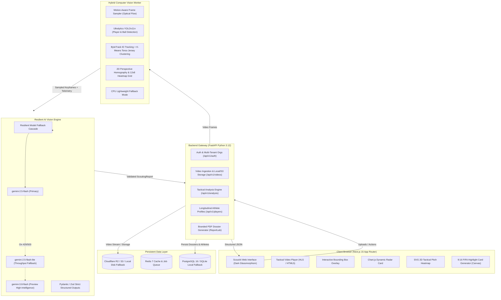

# ScoutAI 2.0 — Production-Grade Multi-Tenant Sports Intelligence Platform

[](https://nextjs.org/)
[](https://fastapi.tiangolo.com/)
[](https://ai.google.dev/)
[](https://github.com/ultralytics/ultralytics)
[](https://www.typescriptlang.org/)
[](https://tailwindcss.com/)

**ScoutAI 2.0** is an enterprise-grade athletic intelligence, biomechanics tracking, and multi-sport scouting SaaS platform. It transforms raw match and training footage into FIFA/Olympic-accredited tactical dossiers, 2D pitch spatial occupancy heatmaps, radar KPI benchmarks, jump kinematics analysis, and verified shareable athlete profiles.

---

## 🏛️ System Architecture



---

## 🚀 Key Innovations in ScoutAI 2.0

### 1. Zero Client-Side Secret Exposure
* Client applications never communicate directly with `generativelanguage.googleapis.com` or store keys in browser `localStorage`.
* All multimodal requests execute securely through the server-side FastAPI backend using strict environment variables (`GEMINI_API_KEY`).

### 2. Resilient Gemini Model Fallback Cascade
* Automatic exponential backoff and dynamic failover across priority models:
  `gemini-2.5-flash` ➔ `gemini-2.5-flash-lite` ➔ `gemini-3.8-flash`.
* Handles HTTP 429 rate limits, 503 capacity surges, and model deprecation without dropping user jobs.

### 3. Mathematically Guaranteed Structured Outputs
* Uses the official `google-genai` SDK with strict Pydantic (`ScoutingReportSchema`) and TypeScript Zod schemas.
* Clamps and validates 0–100 score bounds, letter grades (`S`, `A`, `B`, `C`, `D`), and tactical metrics.

### 4. Hybrid Computer Vision Pipeline
* **Smart Motion Sampler**: Detects action peaks and momentum bursts (shots, spikes, sprints, jump takeoffs) via optical flow rather than blind static intervals.
* **YOLOv11 + ByteTrack**: Detects players (class 0) and sports balls (class 32) with persistent tracking IDs.
* **K-Means Jersey Clustering**: Clusters torso pixels into Team A, Team B, and Goalkeeper/Referee colors.
* **2D Pitch Homography**: Maps player foot bounding coordinates to an authentic 12×8 occupancy zone heatmap.
* **Graceful CPU Mode**: Seamlessly operates on standard laptops without GPU (`CV_MODE=lightweight`).

### 5. Multi-Tenant Persistent Storage & Local Fallback
* Full PostgreSQL 16 + SQLAlchemy database with permanent shareable dossiers (`/p/[slug]`).
* Out-of-the-box local developer mode (`SQLITE_FALLBACK=true`, `STORAGE_MODE=local`) requiring zero paid cloud keys to run locally.

### 6. Full English & Professional Arabic (العربية الفصحى الرياضية)
* Real-time bilingual switcher flipping `dir="rtl"` and generating technical coaching dossiers in either English or Arabic.

---

## 📁 Monorepo Directory Structure

```
scoutai/
├── apps/
│   └── web/                                  # Next.js 15 (App Router), TypeScript, Tailwind CSS
│       ├── public/
│       ├── src/
│       │   ├── app/
│       │   │   ├── (auth)/                   # /login, /register
│       │   │   ├── (dashboard)/              # /dashboard, /upload, /matches/[id], /players/[id], /compare
│       │   │   ├── p/[slug]/                 # Public verified shareable athlete dossier
│       │   │   ├── globals.css               # Dark glassmorphism design tokens (#070b18)
│       │   │   └── layout.tsx
│       │   ├── components/
│       │   │   ├── ui/                       # GlassButton, GlassCard, Badge
│       │   │   ├── video/                    # VideoUploader, TacticalVideoPlayer, BoundingBoxOverlay
│       │   │   ├── analysis/                 # RadarChartCard, PitchHeatmap2D, StrengthsWeaknesses, DrillCards
│       │   │   ├── comparison/               # MultiPlayerCompare (Head-to-head radar & KPI diffs)
│       │   │   └── export/                   # PdfReportExporter, SocialHighlightCard9x16 (Canvas)
│       │   ├── hooks/                        # useLocale, useVideoUpload
│       │   ├── i18n/                         # en.json, ar.json (Bilingual dictionary)
│       │   ├── lib/                          # api-client.ts, sport-presets.ts, schemas.ts
│       │   └── store/                        # Zustand state management (useScoutStore.ts)
│       ├── package.json
│       └── tsconfig.json
├── services/
│   ├── api/                                  # FastAPI (Python 3.12) Backend & Orchestrator
│   │   ├── app/
│   │   │   ├── main.py                       # FastAPI app, CORS, Rate Limiting (SlowAPI), Healthcheck
│   │   │   ├── config.py                     # Pydantic BaseSettings (.env loader)
│   │   │   ├── models/                       # SQLAlchemy models (User, Org, Player, Match, ScoutingReport)
│   │   │   ├── schemas/                      # Pydantic strict schemas for Gemini Structured Outputs
│   │   │   ├── routers/                      # auth.py, videos.py, analysis.py, players.py, billing.py
│   │   │   └── services/
│   │   │       ├── gemini_service.py         # Resilient fallback cascade + Structured Output generation
│   │   │       ├── storage_service.py        # Cloudflare R2 / S3 / Local disk storage fallback
│   │   │       └── pdf_service.py            # Server-side branded scouting PDF generator
│   │   ├── requirements.txt
│   │   └── Dockerfile
│   └── cv-worker/                            # Python Computer Vision & Video Processing Pipeline
│       ├── worker/
│       │   ├── pipeline.py                   # Orchestrates FFmpeg -> YOLO -> ByteTrack -> Homography -> Gemini
│       │   ├── detector.py                   # Ultralytics YOLOv11 player & ball detection
│       │   ├── tracker.py                    # ByteTrack persistent ID tracking + K-Means jersey color clustering
│       │   ├── homography.py                 # 2D top-down pitch coordinate projection & heatmap generation
│       │   └── smart_sampler.py              # Extracts high-action keyframes & 5s event clips via FFmpeg
│       ├── requirements.txt
│       └── Dockerfile
├── packages/
│   └── shared-types/                         # Shared TypeScript interfaces & sport KPI definitions
├── tests/
│   ├── api/                                  # Pytest unit & integration tests for FastAPI & Gemini fallback
│   └── e2e/                                  # End-to-end integration test (Upload -> Detect -> Dossier -> PDF)
├── .env.example
├── docker-compose.yml                        # Postgres 16 + Redis 7 + FastAPI + CV Worker + Next.js
└── README.md
```

---

## ⚡ Quickstart & Local Development

### Option A: Local Node + Python (Recommended for Quick Dev)

1. **Clone repository & prepare environment**:
   ```bash
   cp .env.example .env
   # Edit .env and supply GEMINI_API_KEY (optional for simulated demo mode)
   ```

2. **Install Node & Python dependencies**:
   ```bash
   npm install
   python -m venv .venv
   # Windows:
   .\.venv\Scripts\pip install -r services/api/requirements.txt
   # Linux/macOS:
   source .venv/bin/activate && pip install -r services/api/requirements.txt
   ```

3. **Start All Services**:
   ```bash
   # Linux/macOS:
   chmod +x scripts/dev.sh && ./scripts/dev.sh

   # Windows (PowerShell):
   .\scripts\dev.ps1
   ```

4. **Access Applications**:
   * **Web Application**: [http://localhost:3000](http://localhost:3000)
   * **FastAPI Swagger Docs**: [http://localhost:8000/docs](http://localhost:8000/docs)
   * **API Healthcheck**: [http://localhost:8000/health](http://localhost:8000/health)

---

### Option B: Docker Compose (Production Stack)

To run the complete stack including PostgreSQL 16, Redis 7, FastAPI, CV Worker, and Next.js:

```bash
docker-compose up --build
```

---

## 🧪 Automated Test Suite

Run the complete test suite verifying healthchecks, Pydantic bounds enforcement, model fallback cascades, Arabic translations, and end-to-end flows:

```bash
# Windows
.\.venv\Scripts\pytest tests/ -v

# Linux/macOS
pytest tests/ -v
```

---

## 📋 Environment Configuration Reference

| Variable | Default | Purpose |
| :--- | :--- | :--- |
| `GEMINI_API_KEY` | *(Required for cloud AI)* | Google Gemini API server-side key |
| `PRIMARY_GEMINI_MODEL` | `gemini-2.5-flash` | Primary multimodal vision model |
| `FALLBACK_GEMINI_MODELS` | `gemini-2.5-flash-lite,gemini-3.8-flash` | Resilient model fallback cascade |
| `STORAGE_MODE` | `local` | `local`, `s3`, or `r2` |
| `SQLITE_FALLBACK` | `true` | Runs out-of-the-box without PostgreSQL |
| `DATABASE_URL` | `postgresql://...` | Production database connection string |
| `CV_MODE` | `lightweight` | `lightweight` (CPU contour) or `full` (YOLOv11 GPU) |
| `NEXT_PUBLIC_API_URL` | `http://localhost:8000` | Backend API gateway endpoint |

---

## 🏆 Sport Presets & KPI Taxonomy

ScoutAI 2.0 comes pre-configured with 10 official sporting taxonomies:
1. **Football / Soccer**: Opta/Stats Perform & Wyscout KPI taxonomy (xG, PPDA, Progressive Carries, 8 positions).
2. **Basketball**: Synergy Sports & NBA Second Spectrum taxonomy (eFG%, TS%, PPP, Vertical Leap, 5 positions).
3. **Tennis**: Hawk-Eye Innovations & Tennis Abstract taxonomy (Dominance Ratio, Net Clearance, 4 tactical styles).
4. **Volleyball**: FIVB TSG & Data Volley taxonomy (Kill %, Pass 0-3 Rating, Libero contrasting jersey identification).
5. **Swimming**: World Aquatics / SwimRankings taxonomy (DPS, Turn Velocity, Pacing Index).
6. **Athletics**: World Athletics Biomechanics taxonomy (GCT, Stride Frequency, Acceleration Curve).
7. **Boxing**: CompuBox & BoxRec taxonomy (Jab %, Power %, Ring Generalship).
8. **Gymnastics**: FIG Code of Points (D-Score, E-Score, Amplitude, Stick Landings).
9. **Cycling**: TrainingPeaks (W/kg, Cadence, CdA Drag Coefficient).
10. **Baseball**: MLB Statcast & Baseball Savant (Exit Velocity, Launch Angle, Barrel %, Spin Rate).
11. **Custom Sport**: Extensible dynamic metric model.
